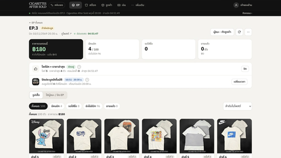
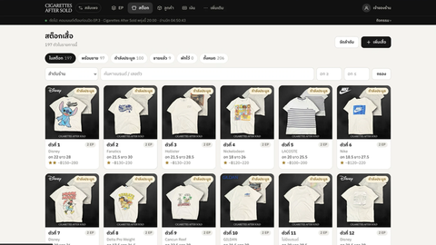

# 👕 Cigarettes After Sold — Auction Back-office

**A web back-office I built to run my online shirt auction shop on Facebook. Every routine task takes a few clicks.**

**Founder & Developer** · Oct 2026 – present · by [Hidayat Buha](https://github.com/Balakkak)

> The source code is private because the system stores customers' names, addresses and chats. This page explains what the back-office does and how it is built.

  
  

*Left: one auction round ("EP"), with live bids, its status and every shirt in one place. Right: the stock page, with every shirt's brand, size and status, searchable.*

---

## Contents

1. [The problem](#1-the-problem)
2. [The workflow](#2-the-workflow)
3. [What the back-office does](#3-what-the-back-office-does)
4. [How it is built](#4-how-it-is-built)
5. [Protecting customer data](#5-protecting-customer-data)
6. [What I learned](#6-what-i-learned)

---

## 1. The problem

I sell shirts by auction on a Facebook page. Each auction round is called an **EP**: one post with many shirt photos, and buyers bid in the comments.

Running it by hand means a lot of repeated work: posting every listing, watching the comments for bids, closing the auction, collecting payments and sending parcels. It is slow, and it is easy to make mistakes.

**Goal:** every routine task should take just a few clicks.

## 2. The workflow

I mapped the four daily tasks first, then built one back-office around them.

| Step | Before | With the back-office |
|---|---|---|
| **1. Post a listing** | Edit each photo, write each caption, post by hand | Turn a pile of phone photos into a ready EP: photos, size labels and captions go to the page in one post |
| **2. Track bids** | Scroll through comments | The back-office reads the comments under each photo in the background |
| **3. Close the auction** | Find each winner, make closing pictures by hand | The closing post is prepared in a few clicks |
| **4. Send parcels** | Collect addresses and tracking numbers from many chats | Tracking numbers are collected and summarized in one place |

Each EP page shows **a step bar and a "next step" box**, so it is always clear where the round stands and what to do next.

## 3. What the back-office does

### Selling
- **New EP from photos:** one job turns phone photos into an EP ready to post. It puts photos upright and in shooting order, cuts out the background, adds the brand logo, and makes a cover with close-ups. If the job stops, it carries on from where it stopped.
- **Post to Facebook:** posts the whole round as one post, with the rules as the caption and each shirt's caption on its own photo.
- **Read bids:** imports an EP post and reads the bids under each photo.
- **Payment deadline:** after an EP closes, each winner has until 10:00 the next morning to pay. If they don't, the shirt goes to the next bidder, as the post's rules say.

### Customers and chat
- **Messenger inbox in the back-office:** read chats, tell each winner what they won, and see their payment slip and address without leaving the page. This is off until the shop switches it on.
- **Slip check:** when a payment slip in the chat is correct, the sale is recorded.
- **Chat rounds:** three times a day, the chats are worked through once. Claude reads each buyer's chat to help sort what they need.

### Running the business
- **Owner overview:** every EP with its sales, ad cost and profit, and the brands that sell. All data can be downloaded as CSV files for Excel or Google Sheets.
- **Post and ad numbers:** reach, clicks, shares, likes and comments for each EP post, and what each EP's ads cost and brought in.
- **Marketing summary:** Claude reads every EP's ad spend, post numbers, bids and sales, and writes a short report in Thai: how the ads did, what to fix, and targets for the next EP.
- **Shirt ranking:** order the stock by sell chance, price, looks, popularity or newest. Sell chance comes from a small logistic model fitted to the shop's own past EPs.
- **Alerts to my phone** (Telegram or email): problems such as Facebook not readable, a token gone or the Mac's battery running low, and things finished such as an EP posted.
- **Activity page:** what the back-office is doing right now (for example making closing pictures), how far along it is, and what it has done.

## 4. How it is built

| Part | Choice |
|---|---|
| Web app | Python + Flask, server-rendered pages that also work on a phone |
| Database | SQLite: pages, shirts, auction rounds, customers, orders, settings. Each page has its own stock and orders; customers are shared. |
| Facebook | Graph API: connect a page once, then post, read comments and read Messenger |
| AI | Claude, through the Claude Code app on the Mac (`claude -p`), for reading chats and photos and for the marketing report |
| Image work | macOS Vision for cutting out the background, plus my own cover and logo scripts |
| Running | A macOS LaunchAgent keeps it running in the background from login, restarts it within about 10 seconds if it stops, and keeps the Mac awake while it works |
| Access | On the same Wi-Fi from a phone, or from outside through a Tailscale Funnel link (every page still needs a login) |
| Tests | Automated tests for the marketing report, post numbers, file tidy-up and the step-by-step EP pages. Tests run against a copy of the data with Facebook faked, never the real shop data. |

## 5. Protecting customer data

Once a tool holds customers' names and addresses, security is part of the design.

- **Login for every page**, with users managed from the Mac or the users page.
- **A PIN lock** in settings.
- **Host check:** only this Mac, private network addresses and the Tailscale link are served.
- **Automatic daily backups**, kept for 14 days.
- Shop data lives outside the project folder, and tests never touch it.

## 6. What I learned

- **Design around the workflow.** A tool is useful when it follows how the work really happens, one task after another.
- **Automate the repeated work.** Removing manual steps gives me time back and cuts mistakes.
- **Protect customer data.** Security is part of the design from the start, not an extra.
